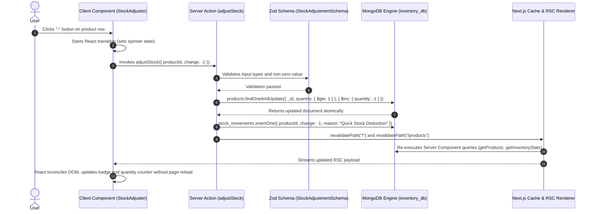

# 📦 MongoDB & Next.js Inventory Management System

A production-grade, educational Inventory Management System built with **Next.js (App Router)**, **TypeScript in strict mode**, and the **official MongoDB Node.js driver** (no ORM/ODM abstraction).

---

## 🎯 Learning Objectives & Highlights
- **Direct MongoDB Driver Usage**: Pure `mongodb` Node.js client operations showing raw queries, filters, projections, atomic operators, and aggregation pipelines.
- **Connection Management & Pooling**: Global singleton client caching (`lib/mongodb.ts`) with `import "server-only"` preventing socket exhaustion during Next.js Hot Module Replacement (HMR).
- **Atomic Operations & Race Condition Prevention**: Atomic `$inc` updates with non-negative query guards (`{ quantity: { $gte: amount } }`) preventing negative inventory under high-concurrency conditions.
- **High-Performance Aggregation Pipelines**: Multi-faceted aggregations (`$facet`, `$group`, `$sum`, `$match`, `$multiply`, `$lookup`) computing warehouse valuations and audit histories directly on the database engine.
- **React Server Components (RSC) & Server Actions**: Server Components for instant data reads; Server Actions for mutations with server-side Zod validation and cache revalidation (`revalidatePath`).

---

## 🚀 Quick Start Guide

### 1. Prerequisites
- **Node.js**: v18.18+ or v20+
- **MongoDB**: A running local MongoDB instance (`mongodb://localhost:27017`) or a free [MongoDB Atlas](https://www.mongodb.com/cloud/atlas) cluster connection URI.

### 2. Environment Configuration
Create your `.env.local` file from the provided template:
```bash
cp .env.example .env.local
```
Inside `.env.local`, set your connection string:
```env
MONGODB_URI=mongodb://localhost:27017/inventory_db
# Or MongoDB Atlas:
# MONGODB_URI=mongodb+srv://<username>:<password>@cluster0.abcde.mongodb.net/inventory_db?retryWrites=true&w=majority
```

### 3. Install Dependencies
```bash
npm install
```

### 4. Seed Database & Establish Indexes
Run the automated seed script to create indexes and populate 15 sample products with stock movement logs:
```bash
npm run seed
```

### 5. Start Development Server
```bash
npm run dev
```
Open [http://localhost:3000](http://localhost:3000) in your browser.

---

## 🔄 How It Works: Request-to-Database Lifecycle

Here is a step-by-step walkthrough of what happens when a user clicks the quick stock decrement button (**`-`**) on the inventory table:



### Detailed Lifecycle Breakdown:
1. **Interactive Trigger**: The user clicks the decrement button in `components/stock-adjuster.tsx` (a small leaf Client Component).
2. **Transition Boundary**: React's `useTransition` starts, marking the action as pending and displaying an inline loading spinner.
3. **Server Action Invocation**: Next.js makes an internal POST request executing `adjustStock()` in `app/actions.ts` securely on the Node.js server.
4. **Zod Validation**: Input is validated against `StockAdjustmentSchema`.
5. **Atomic Database Execution**: 
   - Instead of reading the quantity into memory and writing it back (which causes race conditions), we send an atomic `findOneAndUpdate()` command to MongoDB.
   - The query filter `{ _id, quantity: { $gte: 1 } }` guarantees that if another request already bought the last unit, this query will match zero documents and safely reject the request with an "Insufficient stock" error.
6. **Audit Trail Logging**: A record is appended to the `stock_movements` collection logging the previous quantity, new quantity, timestamp, and reason.
7. **Cache Invalidation & Streaming**: `revalidatePath("/products")` and `revalidatePath("/")` tell Next.js to purge cached RSC payloads. Next.js re-renders the Server Components with the fresh MongoDB data and streams the diff back to the browser.

---

## 📁 Project Architecture

```
db1/
├── app/
│   ├── layout.tsx                # Root layout with top navigation and branding
│   ├── page.tsx                  # Analytics Dashboard (RSC: Aggregations & Audit Trail)
│   ├── products/
│   │   ├── page.tsx              # Product Inventory Table (RSC: Search, Filter, Pagination)
│   │   ├── new/
│   │   │   └── page.tsx          # Create Product Form page (RSC envelope)
│   │   └── [id]/
│   │       └── edit/
│   │           └── page.tsx      # Edit Product Form page (RSC data fetcher)
│   ├── actions.ts                # Server Actions (createProduct, updateProduct, deleteProduct, adjustStock)
│   ├── loading.tsx               # Instant streaming skeleton
│   ├── error.tsx                 # Error boundary
│   └── not-found.tsx             # 404 page
├── components/
│   ├── navbar.tsx                # Server Component header
│   ├── stats-cards.tsx           # Dashboard metric cards
│   ├── category-distribution.tsx # Category valuation progress cards
│   ├── stock-badge.tsx           # In Stock / Low Stock / Out of Stock status indicator
│   ├── stock-adjuster.tsx        # Client leaf component for atomic +/- stock modifications
│   ├── delete-product-dialog.tsx # Client leaf modal with accessible confirmation
│   ├── product-filters.tsx       # Client search input & category selector syncing with URL params
│   ├── product-form.tsx          # Shared Add/Edit form with live Zod error rendering
│   ├── product-table.tsx         # Semantic accessible table with pagination
│   └── ui/                       # Reusable UI primitives (Button, Input, Card, Dialog, Table, Badge, Alert)
├── lib/
│   ├── mongodb.ts                # Cached singleton MongoClient with server-only protection
│   ├── validations.ts            # Zod validation schemas & TypeScript interfaces
│   ├── utils.ts                  # ClassName merger (cn), currency & date formatters
│   └── data/
│       ├── products.ts           # Read queries (getProducts, getProductById, getCategories, getRecentMovements)
│       └── stats.ts              # Aggregation pipeline (getInventoryStats)
├── scripts/
│   └── seed.ts                   # Standalone seed & indexing runner (15 sample products)
├── LEARNING_NOTES.md             # In-depth MongoDB concepts reference guide
├── .env.example                  # Environment configuration template
└── README.md                     # Project documentation
```

---

## 🛠️ Tech Stack
- **Framework**: Next.js (App Router, Server Components & Server Actions)
- **Language**: TypeScript (`strict: true`)
- **Database**: MongoDB (Official `mongodb` Node.js Driver)
- **Validation**: Zod
- **Styling & UI**: Tailwind CSS, Lucide React icons
